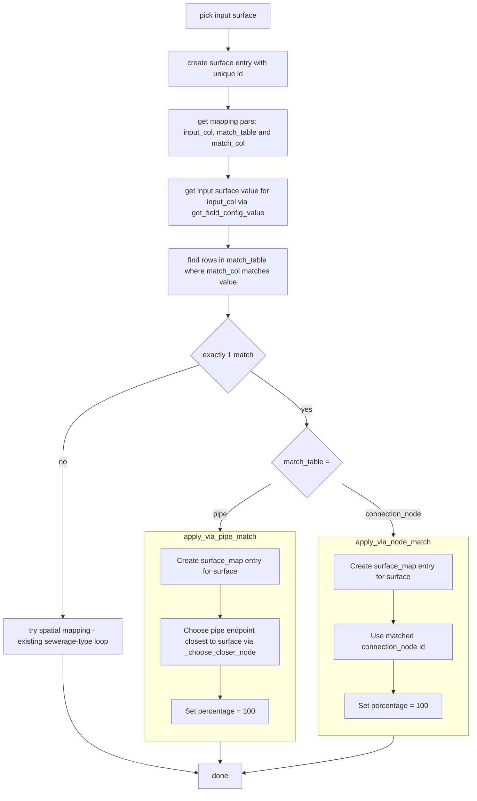

# Attribute-Based Surface Matching Design

## Overview

Extend the surface importer with an optional attribute-based matching mode. When enabled, a value is derived from the source surface feature (via the full `FieldMapConfig` mechanism — ATTRIBUTE / EXPRESSION / DEFAULT) and matched against a column in either the `pipe` or `connection_node` table. If exactly one match is found, a single `surface_map` entry is created with 100% percentage (default, to be made configurable in a future task). If 0 or 2+ matches are found, the processor falls back to the existing spatial (sewerage-type loop) matching.

## Key Decisions

| # | Decision | Choice | Reason |
|---|----------|--------|--------|
| 1 | Attribute matching opt-in? | Yes — spatial remains default | Attribute matching is configured per-import; spatial matching is the default when not configured |
| 2 | Config scope | Global per import (one config, not per sewerage type) | Single `input_col`/`match_table`/`match_col` config for the whole import |
| 3 | Model placement | Extend `SurfaceLinkingSettings` | Simpler, no new classes needed |
| 4 | Sewerage-type loop on attr match | Attr match **replaces** the loop | When attribute match succeeds, only one `surface_map` entry is created |
| 5 | Percentage on attr match | 100% hardcoded | Default for now; to be made configurable in a future task |
| 6 | UI enable/disable | Empty `match_table` combo = disabled; cascading disable | `match_col` disabled when no table selected; `FieldMapWidget` disabled when no column selected |
| 7 | `input_col` widget | Single `FieldMapRow` in `FieldMapWidget` (ATTRIBUTE/EXPRESSION/DEFAULT methods) | Reuses existing field map infrastructure |
| 8 | `match_table` values | Fixed: `"pipe"` or `"connection_node"` | Only these two tables are valid |
| 9 | Widget inheritance | `FieldMapSettingsWidget` + `extra_layout` | Handles `update_layer()` and source attribute population automatically |

## Components

### 1. `SurfaceLinkingSettings` (settings_models.py:259)

Add three optional fields to the existing Pydantic model:

```python
attribute_match_table: Optional[Literal["pipe", "connection_node"]] = None
# "pipe" | "connection_node" | None (disabled)

attribute_match_col: Optional[str] = None
# Column name in the match table layer

attribute_match_input_config: Optional[FieldMapConfig] = None
# FieldMapConfig for deriving the value from the source feature
# Allowed methods: ATTRIBUTE, EXPRESSION, DEFAULT
```

All three default to `None` → attribute matching disabled. Serialization is handled naturally by Pydantic (`model_dump()`).

### 2. `SurfaceConnectionSettingsWidget` (settings_widgets.py:747)

**Inheritance:** Change from `SettingsWidget` to `FieldMapSettingsWidget`.

**`__init__` structure:**

1. Build `extra_layout` (`QGridLayout`) with:
   - Row 0: "Surface map layer" → `QgsMapLayerComboBox` (LineLayer filter)
   - Row 1: "Pipe layer" → `QgsMapLayerComboBox` (LineLayer filter) + "Selected only" `QCheckBox`
   - Row 2: "Connection node layer" → `QgsMapLayerComboBox` (PointLayer filter)
   - Row 3: "Search distance (m)" → `QDoubleSpinBox`
   - Row 4: Separator / section header "Attribute matching"
   - Row 5: "Match table" → `QComboBox` with options `["", "Pipe", "Connection node"]`
   - Row 6: "Match column" → `QComboBox` (populated from selected match table layer's fields; disabled when match_table is blank)

2. Build `row_dict` with one entry for the source value field:
```python
row_dict = {
    "attribute_match_input_config": FieldMapRow(
        label="Source value",
        config=create_field_map_config(
            allowed_methods=[ATTRIBUTE, EXPRESSION, DEFAULT],
            ...
        )
    )
}
```

3. Call `self.setup_ui(row_dict, extra_layout=extra_layout)`

4. Connect signals: all layer combos, spinbox, match_table combo, match_col combo → `_update_model()`

5. Match_table combo change → repopulate match_col combo from `_pipe_layer.currentLayer().fields()` or `_node_layer.currentLayer().fields()` + enable/disable match_col combo and `FieldMapWidget`

**`update_layer(layer)`:**
- Call `super().update_layer(layer)` — populates the source attribute dropdown in the `FieldMapRow` automatically
- Additionally repopulate `match_col` combo from the currently selected match table's layer fields

**`_update_model()`:**
- Reconstruct `self.model = SurfaceLinkingSettings(...)` including all three new attribute-match fields
- `attribute_match_input_config` taken from `self.field_map_widget.get_settings()["attribute_match_input_config"]`

**`get_settings()`:** Returns `self.model`.

**`deserialize(data)`:**
- Restore all grid controls (layer combos, spinbox, match_table, match_col)
- Call `self.field_map_widget.deserialize({"attribute_match_input_config": data.get("attribute_match_input_config", {})})`

**Cascading enable/disable rules:**
- `match_col` combo: enabled only when `match_table` combo is non-empty
- `FieldMapWidget` (source value row): enabled only when `match_col` combo is non-empty

### 3. `SurfaceProcessor._create_surface_map_features()` (processors.py:953)

**New flow (attribute match path added before existing spatial match):**

```
if linking has attribute_match_table configured:
    input_val = get_field_config_value(
        attribute_match_input_config, src_feat, expression_context
    )

    if attribute_match_table == "connection_node":
        matches = [f for f in node_layer.getFeatures()
                   if f[attribute_match_col] == input_val]
        if len(matches) == 1:
            create surface_map entry:
                connection_node_id = matches[0]["id"]
                percentage = 100
            return [surface_map_entry]
        # 0 or 2+ matches: fall through to spatial match

    elif attribute_match_table == "pipe":
        matches = [f for f in pipe_features
                   if f[attribute_match_col] == input_val]
        if len(matches) == 1:
            pipe = matches[0]
            node = _choose_closer_node(surface_geom, pipe, node_layer)
            create surface_map entry:
                connection_node_id = node["id"]
                percentage = 100
            return [surface_map_entry]
        # 0 or 2+ matches: fall through to spatial match

# existing sewerage-type spatial match loop (unchanged)
```

**New extracted helper:** `_choose_closer_node(surface_geom, pipe_feat, node_layer) -> QgsFeature`
- Extracts the start/end node distance comparison from the existing `_create_surface_map_features` (currently duplicated inline, ~lines 1000–1015)
- Reused by both attribute-match path and spatial-match path

**Expression context:** Build a `QgsExpressionContext` from `src_feat` in `process_feature()` and pass it down to `_create_surface_map_features()` to support EXPRESSION method in the `FieldMapConfig`.

## Files Changed

| File | Change |
|------|--------|
| `vector_data_importer/settings_models.py` | Add 3 optional fields to `SurfaceLinkingSettings` |
| `vector_data_importer/wizard/settings_widgets.py` | Redesign `SurfaceConnectionSettingsWidget` to inherit `FieldMapSettingsWidget`; add attribute matching UI section |
| `vector_data_importer/processors.py` | Add attribute-match path in `_create_surface_map_features()`; extract `_choose_closer_node()` helper; wire expression context |

No new files. No changes to `importers.py`, `wizard.py`, or data models.

## Processor Logic Diagram



## Open Questions

- None — all design decisions resolved.

## Future Work

- Make the attribute-match percentage configurable (currently hardcoded to 100%).
